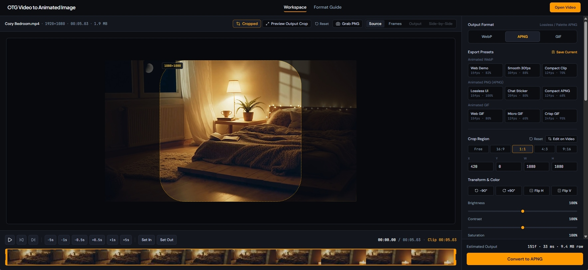

# OTG Video to Animated Image

A fast, 100% client-side browser studio for converting **MP4, MKV, MOV, and WebM** video clips into **Animated WebP, APNG, and Animated GIF** files—with zero server uploads.



## Features

- **Multi-Format Export**
  - **Animated PNG (APNG)** — True 32-bit lossless RGBA at `100%` quality or adaptive 16–256 color palette quantization (`upng-js` + `pako`), with custom `acTL` loop counts.
  - **Animated WebP** — Client-side RIFF (`VP8X` + `ANIM` + `ANMF`) muxer for lightweight 24-bit color + alpha animations.
  - **Animated GIF** — GIF89a encoding (`gifenc`) with 24–256 adaptive color palettes and 1-bit transparency support.
- **Precision Timeline & Trim Controls**
  - Visual filmstrip scrubber with draggable **In / Out** handles, playhead seeking, frame stepping, `-5s / -1s / -0.5s / +0.5s / +1s / +5s` jump buttons, and `60cc / 1s / 2s` quick clip presets.
  - Exact `MM:SS.cc` In/Out timecode inputs with stacked **Up / Down** stepper buttons (`0.10s` step, `Shift` for `1.00s`).
  - Keyboard shortcuts: `Space` (play/pause), `[` (set In), `]` (set Out).
- **Interactive Crop, Transform & Color**
  - 8-handle on-video crop box with `Free`, `16:9`, `1:1` (default), `4:3`, and `9:16` aspect presets.
  - `±90°` rotation, horizontal/vertical flip, plus brightness, contrast, and saturation sliders.
  - Live **Preview Output Crop** canvas mode to inspect rounded corners, sticker borders, chroma key alpha, and captions at 60 fps before encoding.
- **Sticker & Loop Effects**
  - Rounded corner alpha clipping (`0%–50%`) and customizable sticker outline border width & color.
  - **Chroma Key (Alpha)** background removal with color swatches, custom picker, and edge-feathered tolerance.
  - **Caption / Watermark** overlay (`Top`, `Bottom`, `Corner`) with configurable size, opacity, and text color.
  - Speed control (`0.5×–3×`), **Forward / Reverse / Boomerang** playback modes, **Seamless Loop Crossfade** (`4f / 8f / 12f`), and **Hold Final Frame**.
- **Frame Strip Editor & Optimization**
  - Inspect individual captured frames, adjust per-frame delays (`ms`), reorder, duplicate, delete, or auto-merge identical frames (**Dedup Static**).
  - **Target Max File Size** optimizer (`300 KB`–`2 MB`), saved custom presets (`localStorage`), session export comparison strip, **Grab PNG** still frame download, and clipboard **Copy**.

> **Note on MKV playback:** Chromium-based browsers (Chrome, Edge, Brave) natively decode `.mkv` containers using H.264, VP8, VP9, or AV1 video tracks. Clips using HEVC (H.265) or legacy codecs may need to be remuxed to MP4 first.

## Local Development

```bash
npm install
npm run dev
```

Build for production:

```bash
npm run build
```

## Deploying to GitHub Pages

This repository includes `.github/workflows/deploy-pages.yml` for automatic deployment:

1. Push this repository to GitHub on the `main` branch.
2. In your repository on GitHub, open **Settings → Pages**.
3. Under **Build and deployment → Source**, select **GitHub Actions**.
4. Every push to `main` (or manual workflow dispatch) builds `dist/` with the repository's base path and publishes directly to GitHub Pages.

## License

This project is licensed under the **GNU General Public License v3.0 (GPL-3.0)** — see the [GNU GPL v3.0 license text](https://www.gnu.org/licenses/gpl-3.0.html) for details.

